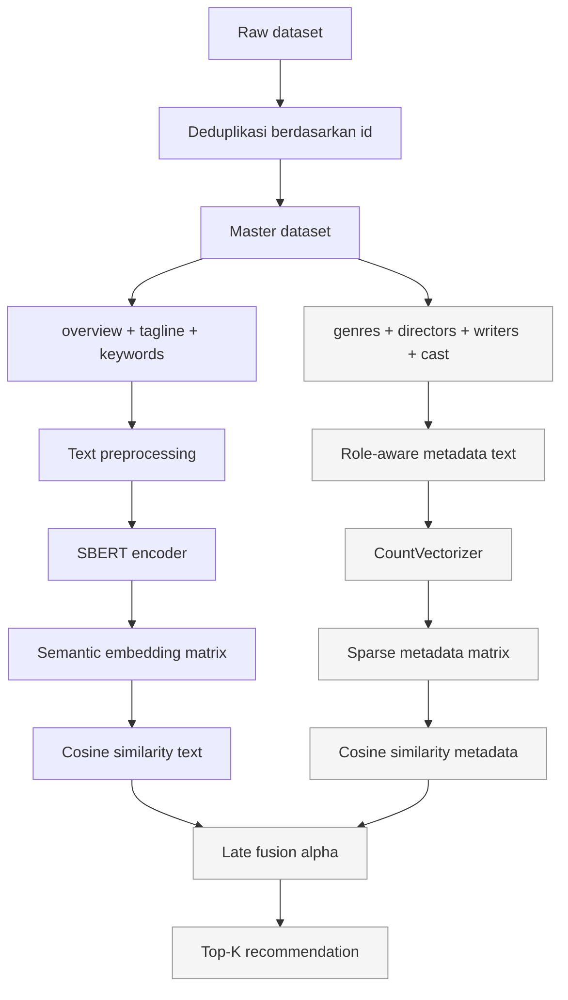
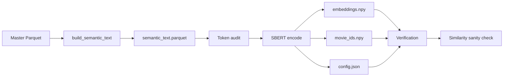

# Research Design — Semantic Text Pipeline

Dokumen ini menjelaskan desain penelitian dan keputusan teknis yang
diimplementasikan pada **Phase 1–3**. Fokusnya adalah pipeline fitur teks
semantik berbasis SBERT. Pipeline metadata, fusion, recommendation engine,
dan evaluasi belum diimplementasikan pada tahap ini.

## 1. Judul dan Tujuan Penelitian

**Judul kerja:** Hybrid Metadata Content-Based Movie Recommendation System.

**Tujuan utama:** menganalisis pengaruh penggabungan fitur teks semantik dan
fitur metadata kategorikal terhadap kualitas rekomendasi film item-to-item.

Penelitian membandingkan tiga kondisi:

1. text-only (`alpha = 1.0`),
2. metadata-only (`alpha = 0.0`),
3. hybrid dengan beberapa nilai `alpha`.

Tahap yang sudah dikerjakan baru menghasilkan representasi fitur untuk
kondisi pertama. Dua kondisi lainnya belum diimplementasikan.

## 2. Pertanyaan Penelitian

1. Seberapa baik fitur teks semantik dari SBERT merepresentasikan kemiripan
   film?
2. Apakah penambahan fitur metadata meningkatkan kualitas rekomendasi
   dibanding text-only?
3. Nilai `alpha` mana yang memberikan performa terbaik berdasarkan proxy
   relevance yang didefinisikan?
4. Bagaimana karakteristik distribusi skor dari masing-masing pipeline, dan
   apakah distribusi tersebut memengaruhi interpretasi `alpha`?

## 3. Ruang Lingkup Tahap Ini

Sudah dikerjakan:

- audit dataset,
- deduplikasi ID,
- pembentukan `semantic_text`,
- audit panjang token,
- encoding SBERT,
- verifikasi artifact,
- sanity check similarity,
- dokumentasi teknis.

Belum dikerjakan:

- fitur metadata dan CountVectorizer,
- cosine similarity formal untuk kedua pipeline,
- fusion `alpha`,
- recommendation engine,
- ground truth dan metrik evaluasi,
- eksperimen tujuh nilai `alpha`.

## 4. Dataset

Dataset mentah berisi 443.610 baris dan 29 kolom. Setelah deduplikasi
berdasarkan `id`, tersisa 429.755 film unik.

Fitur teks yang digunakan:

- `overview`
- `tagline`
- `keywords`

Fitur metadata yang akan digunakan pada Phase 4:

- `genres`
- `directors`
- `writers`
- `cast`

Detail kolom dan statistik missing tersedia di `docs/dataset_dictionary.md`.

## 5. Arsitektur Sistem

### 5.1 Gambaran dua pipeline



Bagian abu-abu belum diimplementasikan. Phase 3 berhenti pada
`Semantic embedding matrix`.

### 5.2 Alur Phase 3



## 6. Deduplikasi

### 6.1 Masalah

Data mentah memiliki 3.463 grup ID duplikat. Baris dalam satu grup tidak selalu
identik; kolom `cast` berbeda pada 3.414 grup. Karena itu, memilih baris pertama
secara arbitrer berisiko membuang informasi yang lebih lengkap.

### 6.2 Aturan yang dipakai

Untuk setiap `id`:

1. Hitung jumlah kolom relevan yang berisi nilai non-whitespace.
2. Pilih baris dengan skor tertinggi.
3. Jika seri, pilih total panjang teks terpanjang setelah whitespace
   dibersihkan.
4. Jika masih seri, pilih baris yang lebih awal.

Kolom relevan: `overview`, `tagline`, `keywords`, `genres`, `directors`,
`writers`, `cast`.

### 6.3 Konsekuensi

- Dataset menjadi 429.755 baris.
- Dibandingkan `keep="first"`, aturan ini memilih baris berbeda pada 2.294 film.
- Data `cast` yang tadinya kosong berhasil dipertahankan untuk 1.662 film.
- Aturan ini adalah **heuristic pemilihan record**, bukan penilaian kualitas
  film.

### 6.4 Alternatif yang tidak dipilih

- `keep="first"`: sederhana, tetapi membuang metadata yang lebih lengkap.
- Menggabungkan seluruh nilai `cast` dari semua duplikat: berisiko mencampur
  versi/rilis yang berbeda dan sulit dipertanggungjawabkan.
- Memilih berdasarkan rating: bukan tujuan penelitian dan dapat menimbulkan
  bias popularitas.

## 7. Pembentukan `semantic_text`

### 7.1 Format

```text
Overview: {overview}

Tagline: {tagline}

Keywords: {keywords}
```

Label dipertahankan agar encoder mengetahui asal informasi. Field kosong
dilewati, bukan menghasilkan label tanpa isi.

### 7.2 Aturan preprocessing

- `NaN` dan `None` diubah menjadi string kosong.
- Whitespace berlebih dirapikan.
- Punctuation dipertahankan.
- Stopwords tidak dibuang.
- Negasi seperti "not" dipertahankan.
- Teks tidak di-lowercase.
- Tidak ada stemming atau lemmatization.
- `keywords` dibiarkan sebagai teks comma-separated; belum dipecah menjadi
  token terpisah.

### 7.3 Placeholder

Audit menemukan empat tagline yang nilainya persis `none`, `n/a`, atau `-`.
Nilai tersebut diperlakukan sebagai kosong.

Asumsi ini eksplisit dan hanya berlaku untuk kecocokan persis
(case-insensitive), bukan untuk kalimat yang mengandung kata tersebut.

### 7.4 Film tanpa teks

Jika ketiga field kosong:

- `semantic_text` bernilai `""`,
- film tetap berada di master dataset,
- film tidak diikutkan dalam encoding SBERT.

Alasannya: encoding string kosong akan menghasilkan vektor dari token khusus,
bukan representasi konten yang bermakna.

## 8. Model SBERT

| Spesifikasi | Nilai |
|---|---|
| Checkpoint | `sentence-transformers/multi-qa-distilbert-cos-v1` |
| Arsitektur | SBERT |
| Backbone | DistilBERT |
| Jumlah layer | 6 |
| Hidden size | 768 |
| Attention heads | 12 |
| Dimensi embedding | 768 |
| Pooling | Mean pooling |
| Normalisasi output | Ya, L2 |
| Max input | 512 token |
| Bahasa pada model card | Inggris |
| Fine-tuning | Tidak dilakukan |

Model digunakan sebagai **feature extractor pretrained**. Bobot tidak diubah.
Tidak ada loss, optimizer, atau backpropagation pada pipeline ini.

## 9. Tokenisasi dan Truncation

- Panjang diukur dengan tokenizer model, bukan jumlah kata.
- `truncation=False` dipakai saat audit agar panjang penuh terukur.
- `max_seq_length` dibaca dari konfigurasi model: 512.
- Teks yang melebihi 512 token akan dipotong saat encoding.
- 16 dari 396.254 teks melewati 512 token.
- 520 teks melebihi 250 token, panjang yang disebut model card sebagai
  rentang training.

Baseline mempertahankan batas 512. Tidak ada perubahan urutan field atau
strategi truncation khusus.

## 10. Artifact dan Alignment

| File | Isi |
|---|---|
| `artifacts/semantic_baseline/semantic_text.parquet` | `id`, `semantic_text` untuk 429.755 film |
| `artifacts/semantic_baseline/token_lengths.parquet` | `id`, `token_length` untuk 396.254 teks |
| `artifacts/semantic_baseline/embeddings.npy` | Matriks `396254 x 768`, `float32` |
| `artifacts/semantic_baseline/movie_ids.npy` | ID film, urutan sama dengan baris embedding |
| `artifacts/semantic_baseline/config.json` | Konfigurasi eksperimen dan versi library |
| `artifacts/semantic/embeddings.npy` | Matriks `388241 x 768`, `float32` untuk dataset final |
| `artifacts/semantic/movie_ids.npy` | ID film final, urutan sama dengan baris embedding |

Aturan alignment:

> Baris ke-i pada `embeddings.npy` selalu merujuk pada `movie_ids[i]`.

ID diambil dari `movies_dedup.loc[texts.index, "id"]`, bukan dari seluruh
master dataset, karena hanya 396.254 film yang memiliki teks.

## 11. Keputusan dan Rasional

| Keputusan | Alasan | Alternatif | Dampak |
|---|---|---|---|
| Deduplikasi memilih record terlengkap | Mempertahankan metadata terbanyak | `keep="first"` | 2.294 film memakai baris berbeda |
| Film tanpa teks tetap di master | Metadata pipeline masih bisa memakainya | Drop dari master | 33.405 film tetap tersedia untuk Phase 4 |
| Label field dipertahankan | Encoder tahu konteks tiap bagian | Gabung tanpa label | Representasi lebih terstruktur |
| Placeholder dianggap kosong | Menghindari noise dari nilai palsu | Biarkan sebagai teks | Empat tagline tidak masuk |
| Tanpa fine-tuning | Fokus penelitian adalah fusion, bukan training encoder | Fine-tuning SBERT | Baseline lebih mudah direproduksi |
| Batas 512 dipertahankan | Mengikuti konfigurasi model | Potong di 250 | Hanya 16 teks terpotong |
| Embedding dinormalisasi | Cosine = dot product | Normalisasi saat query | Perhitungan lebih efisien |

## 12. Asumsi

1. Ketujuh kolom relevan dianggap sama penting dalam pemilihan record.
2. Label `Overview:`, `Tagline:`, dan `Keywords:` cukup memberi konteks kepada
   encoder.
3. Placeholder `none`, `n/a`, dan `-` tidak mengandung informasi.
4. Model pretrained berbahasa Inggris masih dapat memberi sinyal yang berguna
   untuk sebagian teks non-Inggris, tetapi kualitasnya belum terbukti.
5. Truncation pada 16 teks tidak mengubah kesimpulan secara material; ini perlu
   diverifikasi jika hasil evaluasi nanti sensitif terhadap film tersebut.

## 13. Keterbatasan

- Model berfokus pada bahasa Inggris, sementara dataset mengandung teks
  non-Inggris.
- Analisis bahasa menunjukkan query berbahasa Rusia cenderung menarik film
  berbahasa Rusia dengan similarity lebih tinggi; ini bisa mencerminkan
  kesamaan bahasa/script, bukan semata kesamaan tema.
- `original_language` dan `spoken_languages` tidak selalu konsisten.
- 33.501 film tidak memiliki representasi semantik.
- Sanity check similarity belum merupakan evaluasi formal.
- Belum ada ground truth dan metrik Precision/Recall/MAP pada tahap ini.

## 14. Reproducibility

Urutan reproduksi Phase 3:

```text
1. Load raw CSV
2. Validate dataset
3. Deduplicate by id
4. Save master Parquet
5. Build semantic_text
6. Save semantic_text.parquet
7. Token audit
8. Load SBERT checkpoint
9. Encode semantic_text
10. Save embeddings, movie_ids, config
11. Verify artifacts
```

Semua parameter penting dicatat di `artifacts/semantic_baseline/config.json` dan
`artifacts/semantic/config.json`.
